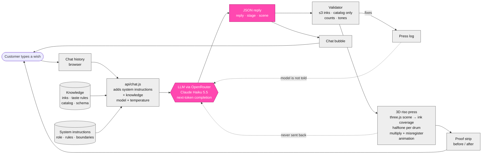

# System Diagram

Grey = deterministic (code). Pink = probabilistic (the model). Dashed = what the model never sees.

**Human judgment:** the customer decides when a proof is final and whether to keep incompatible creatures.
